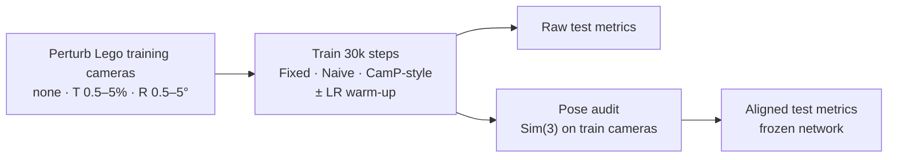

# PoseGuard-NeRF

**When does joint camera-pose optimization help NeRF, and when does it just move the world?**

[](https://github.com/chu-jiaming/PoseGuard-NeRF/actions/workflows/tests.yml)


English | [中文](README.zh-CN.md)

<p align="center">
  
  <br>
  <sub>Lego with 5% translation noise on every training camera. Left: fixed cameras, 14.1 dB.
  Right: joint pose optimization with a camera learning-rate warm-up, 22.7 dB. Same data, same 30k steps.</sub>
</p>

A controlled study of NeRF under noisy camera poses: **45 training runs**
(9 pose-noise levels × 5 methods) on Nerfstudio's vanilla-NeRF, plus pose audits
and a Sim(3) alignment diagnostic that separates *worse reconstruction* from
*a reconstruction that is fine but sits in a shifted coordinate frame*.

## TL;DR

- **Small pose errors wreck fixed-camera NeRF.** Test PSNR falls from 27.1 dB to
  14.1 dB at 5% translation noise and to 12.0 dB at 5° rotation noise.
- **Joint pose optimization recovers much of it,** and a 2,500-step camera
  learning-rate warm-up makes the naive version better in **9/9** conditions
  (+4.3 dB on average; at 5% translation noise, 14.1 → 22.7 dB).
- **But turning it on from perfect poses *lowers* PSNR from 27.1 to 17.9 dB.**
  The diagnosis: the reconstruction drifts as a whole. A Sim(3) fitted only on
  training camera centers, with the network frozen, recovers **+5.5 dB** (Naive)
  and **+6.1 dB** (CamP-style). Raw test metrics conflate scene quality with
  global coordinate drift.

## Method



- **Naive:** a 6-D SO(3) × R³ correction per training camera, optimized jointly
  with the radiance field.
- **CamP-style:** the same correction in a preconditioned space, δ = Pz, where P
  whitens the projection Jacobian of each camera
  ([CamP](https://camp-nerf.github.io/), re-implemented from the idea, not the original code).
- **Warm-up:** the camera learning rate ramps from 1e-8 to 1e-3 over the first 2,500
  steps instead of starting at 1e-3.
- **Alignment diagnostic:** fit a similarity transform between GT and optimized
  *training* camera centers, apply it to the *test* cameras, re-render. No test
  image is used for fitting and no weight is updated.

Full protocol: [docs/EXPERIMENTS.md](docs/EXPERIMENTS.md).

## Results

### 1. Pose noise breaks fixed cameras; pose optimization recovers


Fixed cameras win only with exact poses or 0.5% translation noise. In the
other seven noisy conditions Naive + warm-up is best in six and 0.09 dB behind
CamP-style + warm-up in the seventh (2° rotation).

The recovered cameras show why. Joint optimization pulls the noisy training
cameras back to within 0.025 scene units on average (from 0.16); removing one
global similarity transform brings that to 0.016.


### 2. Most of the "drop from perfect poses" is coordinate drift


The Naive render is sharp but shifted, so its error sits on object edges.
Aligning the test camera with a Sim(3) fitted on training cameras removes most
of it. Full 200-view evaluation, GT initialization:

| Method | Raw PSNR | Sim(3)-aligned PSNR | Gain |
| --- | ---: | ---: | ---: |
| Fixed cameras (identity) | 27.12 | 27.12 | 0.00 |
| Naive | 17.91 | 23.39 | +5.48 |
| CamP-style | 19.90 | 26.04 | +6.14 |
| Naive + warm-up | 22.71 | 26.42 | +3.71 |
| CamP-style + warm-up | 21.08 | 25.98 | +4.90 |

The pose diagnostics logged during training show the same thing: from step
10k on, raw camera-center error stays at 0.7–1.2% of the camera radius, while
the error left after removing one global similarity transform keeps shrinking.


### 3. Warm-up helps, but read it in the right frame

Paired against no warm-up, warm-up improves Naive in **9/9** conditions on PSNR,
SSIM and LPIPS (mean +4.28 dB) and CamP-style in **8/9** (mean +1.63 dB; 5%
translation is the exception). After alignment on the GT condition, the Naive
gain is still +3.03 dB, while the CamP-style gain disappears (−0.06 dB).
Details: [paired analysis](artifacts/analysis/warmup/report.md),
[alignment findings](artifacts/analysis/alignment_full/findings.md).

## Limitations

One scene (Lego), one seed (42). CamP-style is a controlled re-implementation.
The warm-up changes the whole camera learning-rate schedule, so the early phase
alone is not isolated. Full aligned rendering covers the GT condition only. The
alignment is a diagnostic of how test metrics are measured, not a new training
method. These results do not establish behavior on other scenes or seeds.

## Quickstart

Re-check the published numbers on a CPU, with no dataset or checkpoint needed:

```bash
uv sync --extra analysis
uv run python scripts/analysis/analyze_warmup_results.py --plots
uv run python -m unittest discover -s tests -p "test_alignment.py" -v
```

Training, resuming, auditing and aligned rendering need a CUDA GPU. See
[docs/RUNNING.md](docs/RUNNING.md).

## Repository layout

```text
poseguard/          pose-correction model, CamP-style preconditioner, Sim(3) alignment
scripts/
  data/             perturbed-dataset generation
  training/         resumable, lock-protected training pipelines
  evaluation/       pose audit and aligned rendering
  analysis/         paired statistics and reports
  showcase/         import server renders, build README figures
tests/              CPU tests (alignment, orchestration, portability) and GPU tests
artifacts/          archived configs, metrics, poses, reports for all 45 runs (index: artifacts/README.md)
docs/               protocol, running guide, figures
```

## References

- B. Mildenhall et al., *NeRF: Representing Scenes as Neural Radiance Fields for View Synthesis*, ECCV 2020 (method and NeRF-Synthetic data).
- M. Tancik et al., *Nerfstudio: A Modular Framework for Neural Radiance Field Development*, SIGGRAPH 2023.
- K. Park et al., *CamP: Camera Preconditioning for Neural Radiance Fields*, SIGGRAPH Asia 2023.

## License

[MIT](LICENSE)
