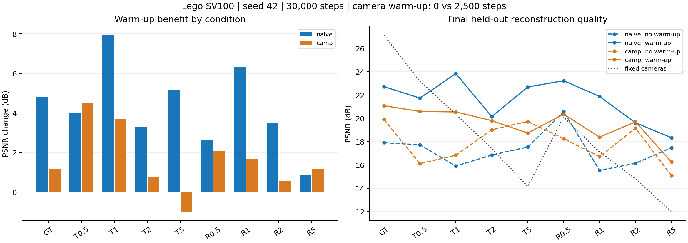
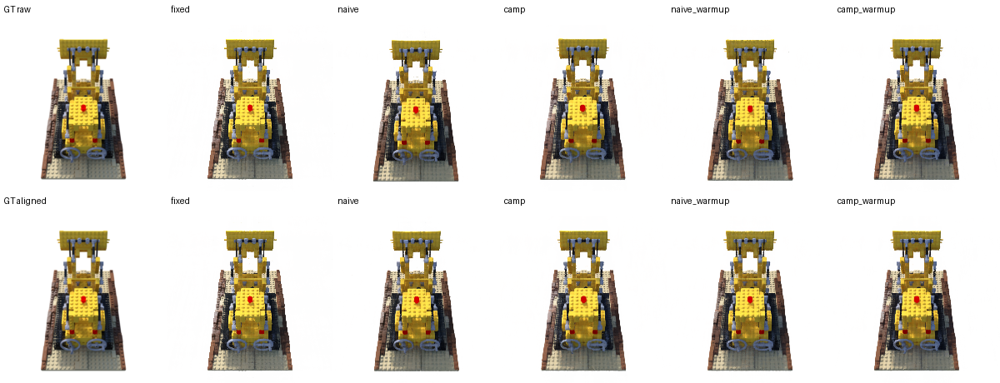

# PoseGuard-NeRF

**相机位姿误差如何影响 NeRF？学习率 warm-up 能改善联合优化吗？评估坐标系又会怎样改变结论？**

基于 Nerfstudio 1.1.5 vanilla-NeRF 的受控实验项目，实现 Naive 与 CamP-style 相机位姿优化，完成扰动敏感性、学习率 warm-up 对照及全局坐标漂移诊断。

Lego 单场景 · 100 训练视角 · seed 42 · 每次 30,000 步 · **45 次训练**（9 fixed + 18 无 warm-up + 18 warm-up）。这是单场景案例研究，未进行跨种子显著性检验。CamP-style 是外参预条件机制的受控实现，区别于官方完整 CamP 设置。

## 主要发现

- **固定相机对位姿误差敏感**：GT 为 27.12 dB，T5% 为 14.14 dB，R5° 为 12.01 dB。
- **相机学习率 warm-up 改善多数条件**：Naive 在 9/9 条件的 PSNR、SSIM、LPIPS 均改善，条件平均 PSNR +4.28 dB；CamP-style 为 8/9，平均 +1.63 dB，T5% 是反例。
- **原坐标测试指标受到全局漂移影响**：GT 条件下，保持模型冻结、用训练相机中心拟合 Sim(3) 后，Naive 从 17.91 提升至 23.39 dB，CamP-style 从 19.90 提升至 26.04 dB。
- **warm-up 的收益需要结合评估协议解释**：GT 对齐后 Naive 仍提升 3.03 dB；CamP-style 变化为 −0.06 dB。对齐后残余差距的具体成因尚未确定。



## 实验设计与结果

只扰动训练外参，图像、内参、验证和测试划分保持不变。9 个条件包括 GT、平移 T0.5/1/2/5%、旋转 R0.5/1/2/5°。所有方法共享 coarse/fine RGB MSE，无 GT 位姿监督、位姿正则或固定锚点。

| 方法 | 位姿参数 | 相机学习率日程 |
|---|---|---|
| Fixed | 固定输入相机 | 不更新 |
| Naive | 直接学习六维 SO3×R3 修正 | 1e-3 → 1e-4 |
| CamP-style | 固定投影 Jacobian 预条件矩阵 × 六维 latent | 同上 |
| 两种 warm-up 变体 | 分别沿用对应参数化 | 前 2500 步从 1e-8 渐增至 1e-3，再衰减 |

warm-up 从第一步更新相机，并非先冻结后启动；后期衰减日程也随之改变。因此实验检验的是整个学习率日程，未单独隔离早期阶段的因果作用。

原坐标下，200 张 800×800 测试图的 PSNR（dB）：

| 条件 | Fixed | Naive | CamP-style | Naive + warm-up | CamP-style + warm-up |
|---|---:|---:|---:|---:|---:|
| GT | 27.12 | 17.91 | 19.90 | 22.71 | 21.08 |
| T0.5% | 23.16 | 17.72 | 16.11 | 21.73 | 20.58 |
| T1% | 20.35 | 15.90 | 16.83 | 23.83 | 20.54 |
| T2% | 17.41 | 16.84 | 19.01 | 20.14 | 19.79 |
| T5% | 14.14 | 17.53 | 19.72 | 22.68 | 18.73 |
| R0.5° | 20.09 | 20.56 | 18.26 | 23.22 | 20.35 |
| R1° | 17.11 | 15.53 | 16.70 | 21.87 | 18.38 |
| R2° | 14.81 | 16.14 | 19.15 | 19.61 | 19.70 |
| R5° | 12.01 | 17.47 | 15.08 | 18.33 | 16.25 |

[原始指标](artifacts/historical/results/poseopt_sv100/summary.csv) · [Warm-up 指标](artifacts/warmup/summary.csv) · [逐条件配对差值](artifacts/warmup/paired_metrics.csv)

## 评估诊断：坐标漂移与残余差距

联合优化可使相机和场景一起改变坐标系。我们仅用训练相机中心拟合一个从 GT 到重建坐标的 Sim(3)，统一变换测试相机位置与朝向，并缩放采样距离。不使用测试图像拟合、不更新网络。

| GT 条件 | 原坐标 PSNR | 对齐后 PSNR | 对齐后与 Fixed 差值 |
|---|---:|---:|---:|
| Fixed | 27.12 | 27.12 | 0.00 |
| Naive | 17.91 | 23.39 | −3.73 |
| CamP-style | 19.90 | 26.04 | −1.08 |
| Naive + warm-up | 22.71 | 26.42 | −0.70 |
| CamP-style + warm-up | 21.08 | 25.98 | −1.14 |

完整诊断使用全部 200 张 800×800 测试图，Fixed 恒等对齐控制通过。另有 20 张 200×200 的成对预览，不能混用两种分辨率的数字。


下面是测试视角 0 的预览对比；仅用于定性展示：



[完整诊断结论](artifacts/alignment_gt_full/findings.md) · [评估协议](ALIGNMENT_DIAGNOSTIC.md)

**解释边界：** 全条件位姿审计覆盖 36 组优化结果，渲染对齐仅覆盖 GT 的五种设置。中心拟合不保证朝向或图像误差最优；PSNR 差值不能严格分解各原因的误差占比。本项目不宣称官方 CamP 的效果、跨场景/跨种子稳定性或 SOTA。

## 查看与复现

阅读本仓库的表格与图片不需要 GPU 或原始数据。发布档案位于 [artifacts/](artifacts/README.md)，包含小型记录、精选图及 SHA-256 清单；不包含原始数据、模型权重、TensorBoard 或完整渲染数组。

重新训练需要 Linux、CUDA GPU、NeRF-Synthetic Lego 数据和兼容环境。环境、数据准备、执行顺序见 [REPRODUCING.md](REPRODUCING.md)。在已配置环境中：

```bash
export POSEGUARD_DATA=/absolute/path/to/nerf_synthetic
PYTHONPATH=. python -m unittest discover -s tests -v
# 已完成 Fixed 基线后检查位姿流水线：
bash scripts/run_pose_optimization_pipeline.sh --preflight
bash scripts/run_pose_optimization_pipeline.sh --dry-run
```

本次整理的检查与限制见 [VALIDATION.md](VALIDATION.md)。

脚本使用当前激活的 Python 环境。新运行会记录自己的配置和指纹；发布档案中的原工作区绝对路径仅用于历史追溯，不能当作新机器上的恢复入口。

## 仓库导航

| 路径 | 内容 |
|---|---|
| [METHODS.md](METHODS.md) | 参数化、代理 Jacobian、预条件和训练定义 |
| [WARMUP_EXPERIMENTS.md](WARMUP_EXPERIMENTS.md) | Warm-up 日程、运行与恢复 |
| [DATA_FLOW.md](DATA_FLOW.md) | 输入、训练、评估、发布档案的数据流 |
| [POSE_OPTIMIZATION.md](POSE_OPTIMIZATION.md) | 串行编排、checkpoint 恢复和故障处理 |
| [PROJECT_SUMMARY.md](PROJECT_SUMMARY.md) | 阶段总结、简历描述和面试讲述 |
| `poseguard/`、`scripts/`、`tests/` | 模型、实验与诊断入口、几何和编排测试 |

## Reference

Park et al., **CamP: Camera Preconditioning for Neural Radiance Fields**, SIGGRAPH Asia 2023. [Paper](https://arxiv.org/abs/2308.10902) · [Project](https://camp-nerf.github.io/).

本项目依赖 Nerfstudio，数据采用 NeRF-Synthetic；第三方代码、数据和论文各自遵循原有条款。本仓库尚未指定开源许可证。
