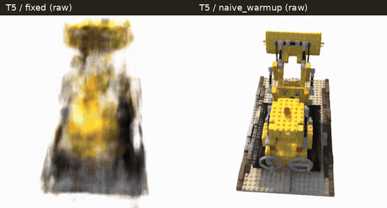
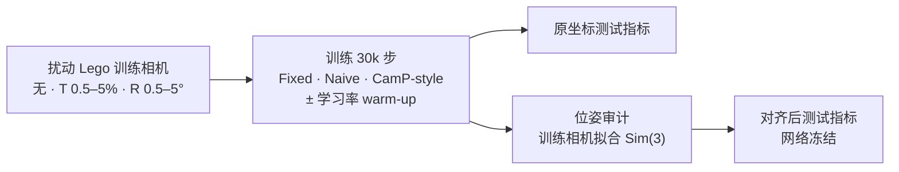
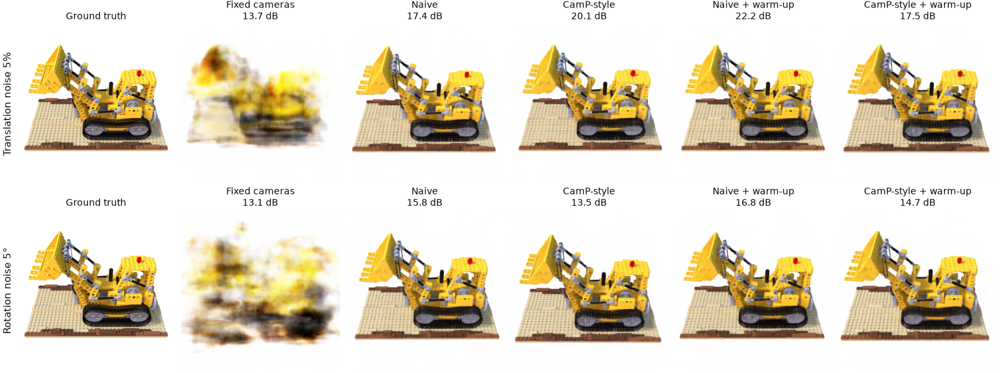
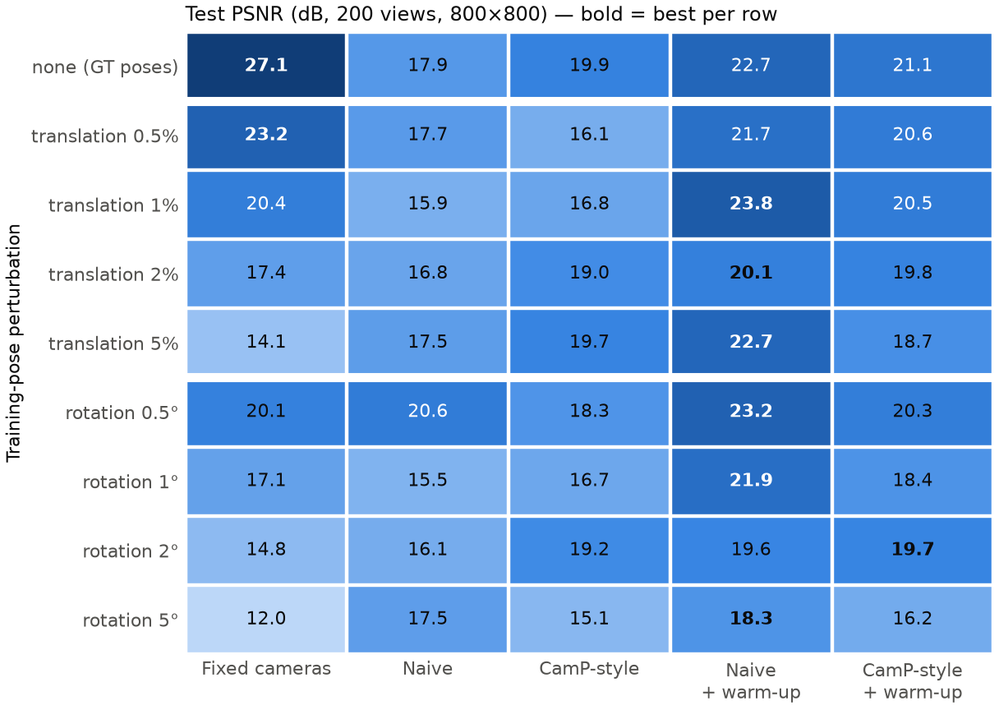
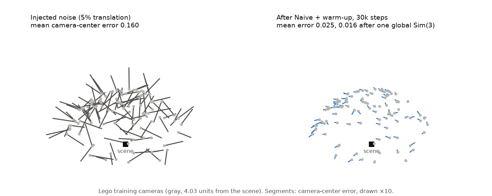
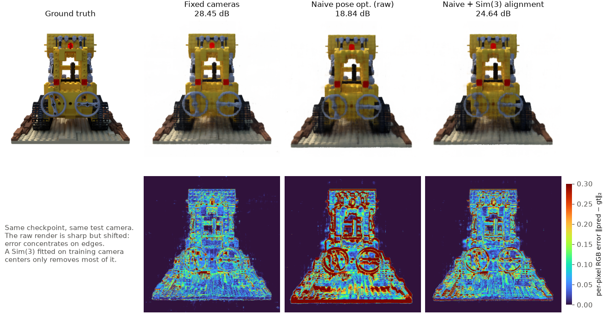
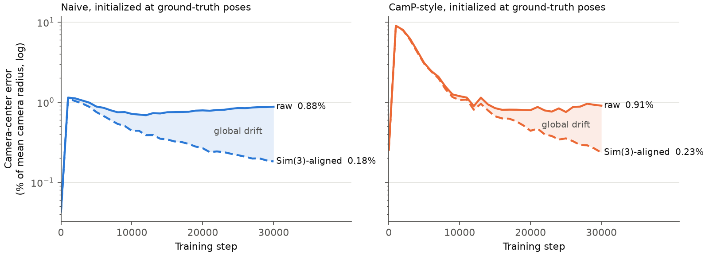

# PoseGuard-NeRF

**联合优化相机位姿，什么时候真的帮了 NeRF，什么时候只是把整个世界挪了位置？**

[](https://github.com/chu-jiaming/PoseGuard-NeRF/actions/workflows/tests.yml)


[English](README.md) | 中文

<p align="center">
  
  <br>
  <sub>Lego 场景，每台训练相机都加了 5% 平移扰动。左：固定相机，14.1 dB。
  右：联合位姿优化 + 相机学习率 warm-up，22.7 dB。数据相同，均训练 30k 步。</sub>
</p>

这是一项关于 NeRF 在相机位姿有误差时表现的受控实验：基于 Nerfstudio vanilla-NeRF 完成 **45 次训练**（9 种位姿扰动 × 5 种方法），并做了位姿审计和 Sim(3) 对齐诊断，用来区分两种情况：**重建本身变差了**，和**重建没问题、只是整体坐标系偏了**。

## 要点

- **很小的位姿误差就能让固定相机的 NeRF 失效。** 测试 PSNR 从 27.1 dB 降到 14.1 dB（5% 平移扰动）和 12.0 dB（5° 旋转扰动）。
- **联合位姿优化能找回大部分损失。** 加上 2,500 步相机学习率 warm-up 后，Naive 方法在 **9/9** 种条件下都更好，平均 +4.3 dB；5% 平移扰动下从 14.1 dB 提升到 22.7 dB。
- **但从完全正确的位姿出发打开优化，PSNR 反而从 27.1 降到 17.9 dB。** 诊断结果是重建发生了整体漂移：冻结网络，只用训练相机中心拟合一个 Sim(3)，Naive 就能找回 **+5.5 dB**，CamP-style 找回 **+6.1 dB**。原坐标下的测试指标，把场景质量和全局坐标漂移混在了一起。

## 方法



- **Naive：** 每台训练相机一个六维 SO(3) × R³ 修正量，与辐射场联合优化。
- **CamP-style：** 同样的修正量，但放在预条件空间里优化，δ = Pz，P 用来白化每台相机的投影 Jacobian。这是按 [CamP](https://camp-nerf.github.io/) 的思路做的受控复现，不是原始代码。
- **Warm-up：** 相机学习率在前 2,500 步从 1e-8 逐渐升到 1e-3，而不是一开始就用 1e-3。
- **对齐诊断：** 用 GT 和优化后的**训练**相机中心拟合一个相似变换，把它应用到**测试**相机上再重新渲染。拟合不使用任何测试图像，也不更新任何权重。

完整实验协议见 [docs/EXPERIMENTS.md](docs/EXPERIMENTS.md)（英文）。

## 结果

### 1. 位姿扰动让固定相机失效，位姿优化把质量找回来





固定相机只在位姿完全正确或只有 0.5% 平移扰动时最好。其余 7 种扰动条件里，Naive + warm-up 在 6 种中最好，剩下的 2° 旋转条件下只比 CamP-style + warm-up 低 0.09 dB。

从恢复出的相机位置可以看出原因：联合优化把带噪声的训练相机拉回到平均距 GT 0.025 个场景单位以内（原始扰动为 0.16）；再去掉一个全局相似变换，误差降到 0.016。



### 2. "从正确位姿出发反而变差"，主要是坐标漂移



Naive 的渲染本身是清晰的，只是整体偏了位置，所以误差集中在物体边缘。用训练相机拟合的 Sim(3) 调整测试相机后，大部分误差就消失了。下表是 GT 初始化条件下 200 张测试图的完整评估：

| 方法 | 原坐标 PSNR | Sim(3) 对齐后 PSNR | 提升 |
| --- | ---: | ---: | ---: |
| 固定相机（恒等对齐） | 27.12 | 27.12 | 0.00 |
| Naive | 17.91 | 23.39 | +5.48 |
| CamP-style | 19.90 | 26.04 | +6.14 |
| Naive + warm-up | 22.71 | 26.42 | +3.71 |
| CamP-style + warm-up | 21.08 | 25.98 | +4.90 |

训练过程中记录的位姿诊断也说明了同一件事：从第 10k 步起，原坐标下的相机中心误差一直维持在相机半径的 0.7–1.2%，而去掉一个全局相似变换后的剩余误差在持续下降。



### 3. Warm-up 有用，但要在正确的坐标系下解读

与不加 warm-up 配对比较时，warm-up 让 Naive 在 **9/9** 种条件下的 PSNR、SSIM、LPIPS 全部改善（平均 +4.28 dB），让 CamP-style 在 **8/9** 种条件下改善（平均 +1.63 dB；5% 平移扰动是例外）。在 GT 条件下做完对齐后，Naive 的 warm-up 收益仍有 +3.03 dB，CamP-style 的收益则消失了（−0.06 dB）。
详见 [配对分析](artifacts/analysis/warmup/report.md) 和 [对齐结论](artifacts/analysis/alignment_full/findings.md)。

## 局限

只有一个场景（Lego）、一个随机种子（42）。CamP-style 是受控复现，不是原始实现。Warm-up 改变的是整个相机学习率日程，没有单独隔离前期阶段的作用。完整的对齐渲染只覆盖了 GT 条件。对齐是对测试指标测量方式的诊断，不是一种新的训练方法。这些结果不能推广到其他场景或其他随机种子。

## 快速开始

在 CPU 上就能复核已发布的数字，不需要数据集或 checkpoint：

```bash
uv sync --extra analysis
uv run python scripts/analysis/analyze_warmup_results.py --plots
uv run python -m unittest discover -s tests -p "test_alignment.py" -v
```

GT 对齐表和 T5 对比所用的 7 个最终 checkpoint 发布在 [v1.0.0 Release](https://github.com/chu-jiaming/PoseGuard-NeRF/releases/tag/v1.0.0)，附 SHA-256 校验和与加载步骤。训练、断点续跑、位姿审计和对齐渲染都需要 CUDA GPU，步骤见 [docs/RUNNING.md](docs/RUNNING.md)（英文）。

## 目录结构

```text
poseguard/          位姿修正模型、CamP-style 预条件、Sim(3) 对齐
scripts/
  data/             生成扰动数据集
  training/         可断点续跑、带文件锁的训练流程
  evaluation/       位姿审计与对齐渲染
  analysis/         配对统计与报告
  showcase/         导入服务器渲染结果，生成 README 图
tests/              CPU 测试（对齐、编排、可移植性）与 GPU 测试
artifacts/          全部 45 次训练的配置、指标、位姿和报告存档（索引见 artifacts/README.md）
docs/               实验协议、运行指南、图片
```

## 参考文献

- B. Mildenhall et al., *NeRF: Representing Scenes as Neural Radiance Fields for View Synthesis*, ECCV 2020（方法与 NeRF-Synthetic 数据集）。
- M. Tancik et al., *Nerfstudio: A Modular Framework for Neural Radiance Field Development*, SIGGRAPH 2023.
- K. Park et al., *CamP: Camera Preconditioning for Neural Radiance Fields*, SIGGRAPH Asia 2023.

## 许可证

[MIT](LICENSE)
