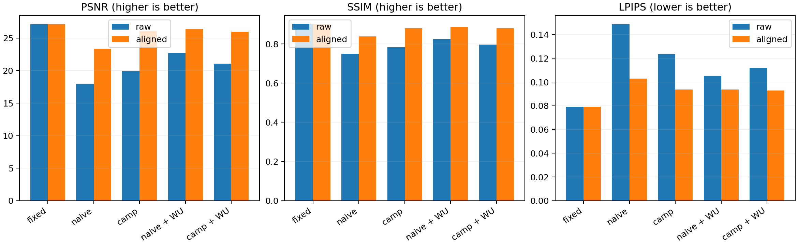

# GT 条件评估诊断

范围、分辨率及评估视角见 [协议与结果表](report.md)。以下数字仅在该次评估协议内比较。
只拟合训练相机中心的全局 Sim(3)，不使用测试图像拟合、不更新网络。

| 方法 | 原坐标 PSNR | 对齐后 PSNR | 对齐提升 | 对齐后相对 fixed |
|---|---:|---:|---:|---:|
| fixed | 27.117 | 27.117 | +0.000 | +0.000 |
| naive | 17.909 | 23.386 | +5.478 | -3.731 |
| camp | 19.900 | 26.037 | +6.137 | -1.080 |
| naive_warmup | 22.707 | 26.419 | +3.711 | -0.699 |
| camp_warmup | 21.076 | 25.979 | +4.904 | -1.138 |

## Warm-up 的配对收益

- naive：原坐标收益 +4.799 dB；对齐后收益 +3.033 dB。
- camp：原坐标收益 +1.175 dB；对齐后收益 -0.058 dB。

## 解释边界

- 对齐收益说明原坐标评估对全局漂移敏感，不能将全部指标下降直接归因为场景本身变差。
- 对齐后与 fixed 的差距是残留性能差距；单凭此实验无法在局部位姿误差、场景拟合不足等原因之间做因果判定。
- 中心拟合不保证相机朝向或图像误差最优；这是诊断性对齐，不是利用测试图像求出的最佳结果。
- dB 差值不能用来严格分解各原因的误差占比，也不能作为跨场景、跨种子稳定性的证据。

