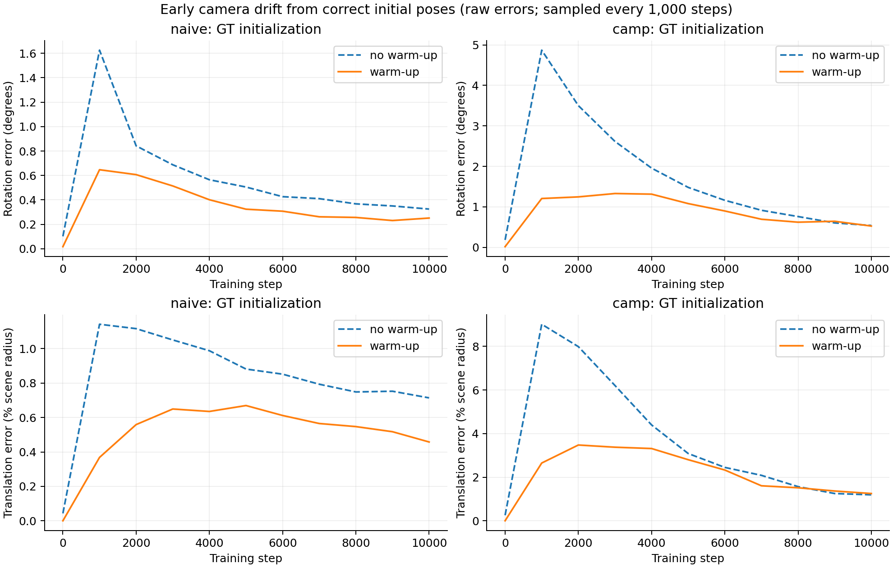

# Warm-up 配对实验分析

> 状态说明：本报告写于对齐诊断之前，下面的数字仍然有效。文中“Sim(3) 对齐没有作用于渲染评估”和“下一步”第 2 条已过时：GT 条件的对齐渲染评估已完成，见 [对齐结论](../alignment_full/findings.md)；多种子（第 3 条）与 delay 对照（第 4 条）未执行。

范围：Lego 单场景、SV100 九种扰动条件、seed 42、每组 30,000 步。18/18 个实验成功。
已核对两轮 manifest：数据、固定相机基线、环境一致，仅代码指纹不同。18 对保存配置仅 warmup_steps（0→2500）及输出路径不同。

## 核心结果

naive 的 9 个条件在 PSNR、SSIM、LPIPS 上全部改善；CamP 的 8 个条件在三个指标上改善，T5 三个指标均退化。

| 方法 | PSNR 前→后 | ΔPSNR | SSIM 前→后 | LPIPS 前→后 | PSNR 改善条件 |
|---|---:|---:|---:|---:|---:|
| naive | 17.289 → 21.568 | +4.279 | 0.7506 → 0.8061 | 0.1651 → 0.1154 | 9/9 |
| camp | 17.861 → 19.488 | +1.627 | 0.7555 → 0.7770 | 0.1573 → 0.1340 | 8/9 |

下列是条件间算术平均，不能作为跨场景或跨种子统计显著性证据。

| 条件 | naive PSNR 前→后 | Δ | CamP PSNR 前→后 | Δ |
|---|---:|---:|---:|---:|
| SV100-GT | 17.91 → 22.71 | +4.80 | 19.90 → 21.08 | +1.18 |
| SV100-T0.5 | 17.72 → 21.73 | +4.01 | 16.11 → 20.58 | +4.47 |
| SV100-T1 | 15.90 → 23.83 | +7.93 | 16.83 → 20.54 | +3.71 |
| SV100-T2 | 16.84 → 20.14 | +3.30 | 19.01 → 19.79 | +0.79 |
| SV100-T5 | 17.53 → 22.68 | +5.15 | 19.72 → 18.73 | -0.99 |
| SV100-R0.5 | 20.56 → 23.22 | +2.66 | 18.26 → 20.35 | +2.09 |
| SV100-R1 | 15.53 → 21.87 | +6.34 | 16.70 → 18.38 | +1.68 |
| SV100-R2 | 16.14 → 19.61 | +3.47 | 19.15 → 19.70 | +0.54 |
| SV100-R5 | 17.47 → 18.33 | +0.86 | 15.08 → 16.25 | +1.16 |

## 退化是否消失？

没有。两种方法优于固定相机基线的 PSNR 条件数均从 4/9 增至 7/9；GT 和 T0.5 仍低于固定相机。
GT：固定相机 27.12 dB，naive + warm-up 22.71 dB，CamP + warm-up 21.08 dB，分别相差 -4.41 和 -6.04 dB。
T0.5 的 PSNR/SSIM 低于固定相机，但 LPIPS 更好，因此不能笼统称为所有视觉指标均退化。
warm-up 后 naive 在 8/9 条件的 PSNR 优于 CamP；只有 R2 的 CamP 高 0.089 dB。这个排序只适用于本实现与本设置。

## 早期相机漂移

GT 初始化提供了最直接的诊断：初始相机本来正确，早期偏离可直接观察。第 1,000 步：
| 方法 | 原始旋转误差（°）前→后 | 原始平移误差（场景半径 %）前→后 |
|---|---:|---:|
| naive | 1.626 → 0.647 | 1.142 → 0.368 |
| CamP | 4.870 → 1.206 | 9.017 → 2.649 |

这些结果支持“减弱早期相机更新可抑制漂移”的解释，但未证明场景未学好是唯一原因。该实验仍从第一步更新相机，未测试完全冻结后的延迟启动。

## 位姿精度与评估坐标

naive 对齐后平均旋转误差从 0.2036° 降至 0.1408°，平均平移误差从 0.2568% 降至 0.2114%。
CamP 对齐后平均旋转误差几乎不变（0.1313°→0.1310°），平移误差略升（0.2669%→0.2685%）。CamP 的渲染改善不能简单等同于位姿精度全面改善。
本实现只在训练分支修正相机，测试视角保持原始坐标。Sim(3) 对齐只用于位姿诊断，没有作用于渲染评估。
因此 PSNR 的变化可能混合场景质量变化与全局坐标漂移。CamP/R1 的原始平移误差从 1.015% 升至 3.250%，但对齐后从 0.268% 降至 0.257%，提示这一区分非常重要。
CamP/T5 的 PSNR 下降 0.986 dB，原始平移误差 0.741%→1.642%，而对齐后 0.280%→0.285%；全局漂移是待验证解释，不能据此直接确认为原因。

## 结论边界与下一步

1. 将 warm-up 作为后续 naive 基线；当前证据表明它明显改善这一个场景的多个扰动条件。
2. 先用已有 checkpoint 补充统一坐标对齐的 held-out 评估，以分辨坐标漂移与实际场景质量；同时保留原始坐标评估。无需先重训。
3. 在 GT、T1、T5 等代表条件补做至少 3 个配对随机种子，检验跨运行稳定性；固定初始化和同一组数据扰动。
4. 再比较无 warm-up、warm-up、降低相机学习率，以及固定前 K 步的 delay；避免一次改多个因素。
5. 本次内置日程在 warm-up 后用剩余 27,500 步衰减，所以后期学习率也与原实验不同；它验证了完整日程调整的效果，尚未完全隔离早期阶段的因果作用。

推荐表述：在 Lego SV100、seed 42 的配对实验中，相机学习率 warm-up 改善了 naive 的全部条件和 CamP 的大多数条件，并降低了正确相机初始化下的早期漂移，但未消除低噪声条件的性能退化，也未证明跨种子稳定性。
